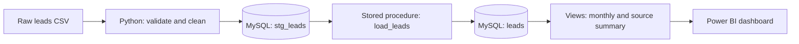

# Lead Data Pipeline: Python → MySQL → Power BI

An automated pipeline that cleans messy sales-lead data in Python, loads it into MySQL, runs the analysis with stored procedures, and feeds a Power BI dashboard. It is built for files that arrive daily with the same structure.

## Business problem

Lead data from different channels arrives messy: inconsistent source names ("LINKEDIN", "Linkedin", "Web site"), mixed date formats, currency symbols in deal values, blank rows and duplicates. Cleaning it by hand every day is slow and error-prone. This project automates the whole flow, from the raw file to the dashboard.

## Pipeline

## What it does

**Python (pandas)**
- Validates the file's columns before processing
- Removes blank rows and duplicates (after standardising, so `LINKEDIN` and `Linkedin` match)
- Standardises the `source` column: Website, LinkedIn, Cold Call, Referral, Indeed
- Fixes mixed date formats and adds a `Month` column
- Cleans `deal_value` (removes the ₹ symbol and commas)
- Flags invalid or missing emails
- Flags outliers in won deal values using the IQR method
- Logs every run and moves files to `processed/` or `failed/`

**MySQL**
- `stg_leads` is a staging table, replaced on each run
- `load_leads()` merges new rows into `leads` (upsert on `lead_id`), so history is kept
- Stored procedures for the analysis: leads by source, conversion rate, running total of deal value, monthly deal value, and `Analysis()` to run them all
- Views `vw_monthly_summary` and `vw_source_summary` for reporting

**Power BI**
- Connects directly to the MySQL views, with no manual export
- Shows KPI cards, monthly deal value, conversion rate by source, leads by source and revenue by source

## Key findings (80 leads, ₹95.5L total deal value)

1. **Revenue is concentrated in two months.** September and October brought in ₹93.0L of ₹95.5L, about 97%.
2. **September to October dipped about 11%.** Deal value fell from ₹49.3L to ₹43.8L. November was still in progress.
3. **Referral and LinkedIn drive most of the revenue.** Together they generate over 90% of deal value.
4. **Conversion is similar across channels, but deal size is not.** Cold Call and Website convert at about the same rate as LinkedIn, yet bring in far less revenue.
5. **Indeed is the weakest channel.** 6 leads and almost no revenue; the sample is too small for a firm conclusion.

## Assumptions

- Dates in ISO format (`2026-09-06`) are read as year-month-day. Other formats (`16.09.2026`, `09/10/2026`) are read day-first.
- Rows without a `lead_id` are dropped. A missing `rep_id` is set to 0 (unassigned).
- Duplicates are removed by `lead_id`, keeping the first occurrence.
- Outliers are calculated per daily file, on won deals only.
- Only a small sample of the raw data is included in `data/`.

## How to run

1. Install the packages: `pip install -r requirements.txt`
2. Run `sql/leads_db.sql` in MySQL Workbench to create the database, tables, procedures and views.
3. Set your MySQL password as an environment variable (Windows): `setx DB_PASSWORD "your_password"`, then reopen the terminal.
4. Put a CSV with the columns `lead_id, rep_id, source, status, created_date, deal_value, email` in `python/incoming/`.
5. Run `python python/pipeline.py` (add `--no-sql` for a dry run without MySQL).
6. Open the `.pbix` file in Power BI Desktop, point it at your MySQL server and click Refresh.

To run it daily, schedule `pipeline.py` with Windows Task Scheduler.

## Tech stack

Python (pandas, NumPy, SQLAlchemy, PyMySQL) · MySQL · Power BI · Windows Task Scheduler

## Next steps

- Email alert when a file fails
- Automated tests for the cleaning functions
- Scheduled refresh in Power BI Service with a gateway

## Author

**Arjun Ajikumar**: [LinkedIn](https://www.linkedin.com/in/your-profile) · [Portfolio](https://arjunajikumar-svg.github.io/)
